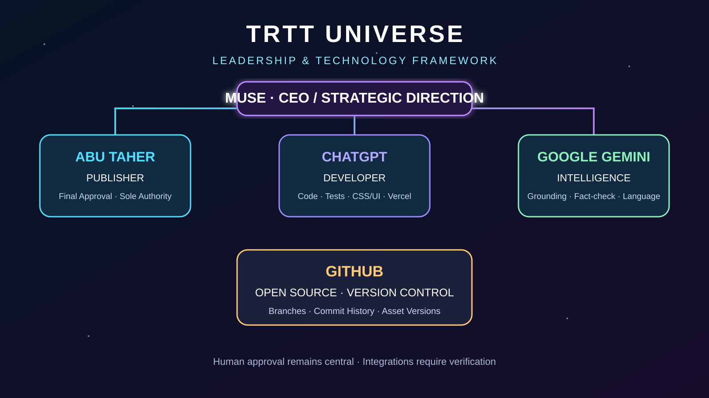

# TRTT UNIVERSE-এর নেতৃত্ব ও প্রযুক্তিগত কাঠামো প্রকাশ

**সানলুরি, সার্ডিনিয়া, ইতালি** — TRTT UNIVERSE প্রকল্পের নেতৃত্ব, প্রকাশনা-সংক্রান্ত অনুমোদন, কৃত্রিম বুদ্ধিমত্তাভিত্তিক উন্নয়ন, তথ্য যাচাই এবং ওপেন-সোর্স সংস্করণ নিয়ন্ত্রণের জন্য একটি সমন্বিত কাঠামো তুলে ধরেছে।

এই কাঠামোতে **MUSE**-কে কৌশলগত দিকনির্দেশনা ও মাননিয়ন্ত্রণের ভূমিকা এবং **Abu Taher**-কে প্রকাশক ও চূড়ান্ত সিদ্ধান্ত গ্রহণকারী হিসেবে নির্ধারণ করা হয়েছে। প্রযুক্তিগত উন্নয়ন, গবেষণা ও সংস্করণ নিয়ন্ত্রণে ChatGPT, Google Gemini এবং GitHub-এর নির্দিষ্ট ভূমিকা রাখা হয়েছে।

## কে কোন দায়িত্বে

- **MUSE — CEO / Strategic Direction:** প্রকল্পের লক্ষ্য, কৌশলগত দিকনির্দেশনা ও মাননিয়ন্ত্রণে পরামর্শ দেবে।
- **ABU TAHER — Publisher / Final Approval:** প্রকাশনার চূড়ান্ত অনুমোদন, প্রকল্পের সিদ্ধান্ত এবং অঙ্গীকারের একক চূড়ান্ত কর্তৃত্ব তাঁর হাতে থাকবে।
- **CHATGPT — Developer:** পরিচ্ছন্ন কোড, ইউনিট টেস্ট, CSS ও ইউজার-ইন্টারফেস আর্কিটেকচার এবং Vercel-সম্পর্কিত উন্নয়নকাজে সহায়তা করবে।
- **GOOGLE GEMINI — Intelligence:** লাইভ তথ্যের ভিত্তি যাচাই, ফ্যাক্ট-চেকিং, AI Overview-ভিত্তিক গবেষণা এবং বহুভাষিক সহায়তা দেবে।
- **GITHUB — Open Source ও Version Control:** ব্রাঞ্চ নিয়ন্ত্রণ, কমিটের ইতিহাস, অ্যাসেটের সংস্করণ এবং কঠোর পরিবর্তন-নিয়ন্ত্রণ প্রক্রিয়ায় সহায়তা করবে।

## চূড়ান্ত অনুমোদন মানুষের হাতেই

এই কাঠামোর মূল নীতি হলো—প্রযুক্তি ও AI সহায়তা দিতে পারে, কিন্তু প্রকাশনা ও গুরুত্বপূর্ণ সিদ্ধান্তের চূড়ান্ত দায়িত্ব মানুষের। AI দিয়ে তৈরি গবেষণা, লেখা বা কোড যাচাই না করে সত্য, পরীক্ষিত কিংবা প্রকাশের জন্য প্রস্তুত বলে ধরে নেওয়া হবে না। প্রকল্পের চূড়ান্ত সিদ্ধান্ত ও অনুমোদন Abu Taher-এর হাতে থাকবে।

এখানে উল্লেখিত দায়িত্বগুলো প্রকল্পের নির্ধারিত বা পরিকল্পিত কাজের বিভাজন তুলে ধরে। এর অর্থ এই নয় যে প্রতিটি API সংযোগ, স্বয়ংক্রিয় ব্যবস্থা, সার্ভিস বা ডিপ্লয়মেন্ট ইতিমধ্যে চালু হয়েছে। কোনো সুবিধাকে কার্যকর বা লাইভ বলা হলে তার বাস্তব পরীক্ষা ও প্রমাণ থাকতে হবে।

## জবাবদিহির সঙ্গে প্রযুক্তি উন্নয়ন

প্রকল্পে GitHub-এর ব্রাঞ্চ ও কমিট ইতিহাস ব্যবহার করে কোডের পরিবর্তনগুলো অনুসরণযোগ্য রাখার লক্ষ্য রয়েছে। অনুমোদনের আগে উন্নয়নকাজ পর্যালোচনা ও পরীক্ষা করা হলে বিদ্যমান ফিচার সুরক্ষিত রাখা এবং অনিচ্ছাকৃত পরিবর্তন কমানো সহজ হয়।

এই ব্যবস্থায় ChatGPT ও Gemini-কে পরস্পরের পরিপূরক সহকারী হিসেবে দেখা হয়েছে—ChatGPT প্রযুক্তিগত বাস্তবায়নে এবং Gemini গবেষণা ও তথ্য যাচাইয়ে সহায়তা করবে।

পাঠকদের জন্য মূল বার্তাটি হলো: প্রযুক্তি মানুষের সিদ্ধান্তকে আরও তথ্যসমৃদ্ধ করবে, কিন্তু প্রকাশনা ও চূড়ান্ত অনুমোদনের জবাবদিহি মানুষের কাছেই থাকবে।

## TRTT UNIVERSE সম্পর্কে

TRTT UNIVERSE হলো **Sanluri to Universe** ভাবনার সঙ্গে যুক্ত TRTT প্রকল্পের একটি অংশ। এর ঘোষিত লক্ষ্য মানবিক নেতৃত্ব, AI-সহায়তাপ্রাপ্ত কাজ এবং স্বচ্ছ উন্নয়ন প্রক্রিয়াকে একসঙ্গে এগিয়ে নেওয়া।

**সম্পাদকীয় স্পষ্টীকরণ:** এই প্রতিবেদনটি প্রকল্পের ঘোষিত নেতৃত্ব ও কাজের কাঠামো বর্ণনা করছে। এখানে উল্লেখিত সব ইন্টিগ্রেশন বা স্বয়ংক্রিয় সুবিধা ইতিমধ্যে চালু কিংবা স্বাধীনভাবে যাচাইকৃত—এমন দাবি করা হচ্ছে না।

*TRTT UNIVERSE — মানুষের দিকনির্দেশনা। AI-এর সহযোগিতা। জবাবদিহিমূলক প্রকাশনা।*
