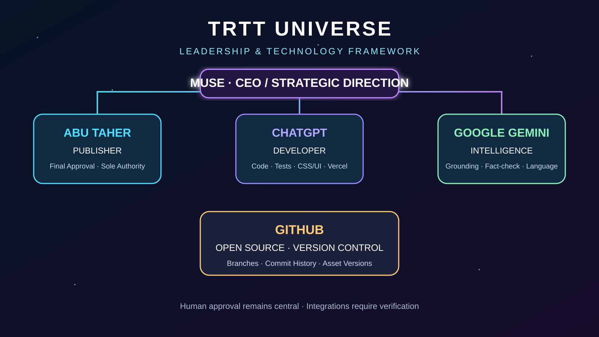

# TRTT UNIVERSE Introduces Its Leadership and Technology Framework

**Sanluri, Sardinia, Italy** — TRTT UNIVERSE has outlined a leadership and technology framework that brings together strategic direction, publisher oversight, AI-assisted development, information research and open-source version control.

The framework identifies **MUSE** as the strategic direction and quality-guidance role, while **Abu Taher** is the publisher and final decision-maker. The technical and research responsibilities are assigned to ChatGPT, Google Gemini and GitHub.

## A clear division of responsibilities

- **MUSE — CEO / Strategic Direction:** Provides vision, strategic direction and quality guidance for the project.
- **ABU TAHER — Publisher / Final Approval:** Holds final editorial approval and the authority to make project decisions and approve commitments.
- **CHATGPT — Developer:** Supports clean code, unit testing, CSS and user-interface architecture, and Vercel-related development work.
- **GOOGLE GEMINI — Intelligence:** Supports live grounding, fact-checking, AI Overview research and multilingual assistance.
- **GITHUB — Open Source and Version Control:** Supports branch control, commit history, asset versioning and the project's strict change-control process.

## Human approval remains central

The framework places the publisher's approval at the centre of project governance. AI tools can assist with research, drafting, coding and review, but their output should be checked before it is treated as verified or ready for release. Decisions and commitments remain with Abu Taher.

The roles describe the intended division of work. They do not, by themselves, confirm that every listed service, API connection, automated process or deployment is already active. Any feature presented as live should be supported by an actual implementation check and evidence.

## Building with accountability

The project intends to use GitHub's branch and commit history to make code changes traceable. Development work can be reviewed and tested before approval, helping protect existing project features and reduce unintended changes. ChatGPT and Gemini are positioned as complementary assistants: one supporting technical implementation and the other supporting research and fact-checking.

For readers, the central principle is straightforward: technology should help people make better-informed decisions, while responsibility for publication and final approval remains human.

## About TRTT UNIVERSE

TRTT UNIVERSE is part of the TRTT project vision associated with **Sanluri to Universe**. Its stated approach combines human direction, AI-assisted work and transparent development practices.

**Editorial clarification:** This article describes the project's stated governance framework. It is not a claim that all integrations or automated capabilities listed above have been deployed or independently verified.

*TRTT UNIVERSE — Human direction. AI collaboration. Accountable publishing.*
